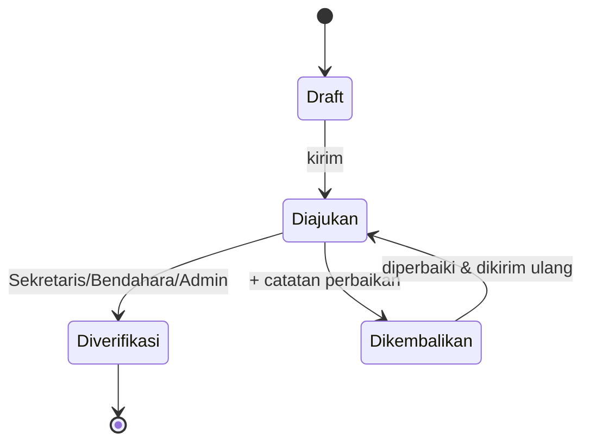

# Laporan Mengawas & Rekap

[← Daftar fitur](README.md)

## Laporan mengawas

Asisten yang berjaga mengisi laporan untuk setiap shift.

- Form **terisi otomatis** dari jadwal shift hari ini, atau shift kemarin yang belum dilaporkan.
- Isian: jam, kelas/kegiatan, materi (otomatis dari topik pertemuan), deskripsi kegiatan, **tim asisten jaga**
  (penanggung jawab + anggota, maks. 4), dan **foto dokumentasi** (wajib, ≤ 5 MB).
- Laporan dapat diubah sampai **H+1 pukul 23.59**, setelah itu terkunci. Admin dapat membuka kunci sampai
  besok 23.59.
- Pencarian mencakup seluruh isi laporan, termasuk hari/tanggal dalam berbagai format ("kamis",
  "1 oktober", "01/10/2026").

### Verifikasi

Hanya laporan **Diverifikasi** yang masuk rekap dan rekap jam.

## Generate rekap bulanan

| Format                  | Isi                                                                                                                | Proses                     |
| ----------------------- | ------------------------------------------------------------------------------------------------------------------ | -------------------------- |
| **ZIP (Word per hari)** | Satu file `.docx` _Laporan Kegiatan Harian_ per tanggal, dari template `resources/templates/laporan-mengawas.docx` | Antrean (progres terlihat) |
| **Excel**               | Rekap seluruh laporan pada periode                                                                                 | Antrean                    |
| **Word satu hari**      | Laporan satu tanggal tertentu                                                                                      | Unduh langsung             |

- Asisten biasa merekap laporannya sendiri. Sekretaris/Bendahara dan Admin dapat merekap **semua asisten**.
- File hasil berlaku 24 jam dan dihapus otomatis setelah 7 hari (`exports:prune`).
- Kop & logo laporan diubah langsung di file template Word. Penanda `${...}` jangan dihapus.

## Rekap jam & SKS mengawas

Revisi Kepala Lab (12 Nov 2026): sistem **tidak menghitung honor**. Asisten tidak mengetahui tarif per jam,
jadi yang dicatat hanya jam dan SKS.

- Rekap bulanan per asisten: jumlah shift dan **jam jaga dari laporan terverifikasi**, dirinci **per mata kuliah**
  beserta **SKS** mata kuliah itu. Setiap anggota tim jaga mendapat jam laporan tersebut.
- Tampil di Generate; Excel punya sheet Ringkasan, Per Mata Kuliah, dan Detail.
- Setiap asisten melihat rekap miliknya; Sekretaris/Bendahara (atau Admin) melihat semua asisten.
- Tidak ada tarif, nominal rupiah, maupun persetujuan rekap.

## Rekap Jam Ngawas (format kampus)

Spesifikasi lengkap: [`../11-prd-rekap-jam-ngawas.md`](../11-prd-rekap-jam-ngawas.md). Halaman: **Asisten › Generate › Rekap Jam Ngawas**.

**Rumus jam:** `SKS × 50 ÷ 60` per sesi (bukan jam mulai–selesai). SKS dari `courses.credits` atau `outside_classes.credits`.
Total per asisten dibulatkan `ROUND(…,0)` setengah ke atas, seperti template kampus. Rekap jam lama di halaman Generate
memakai rumus yang sama.

**Status pelaksanaan laporan:** Terlaksana, Ditiadakan (0 jam), Pengganti, Tambahan, UTS/UAS. Kelas di luar Lab IR memakai SKS
dari data kelasnya dan sel diberi warna oranye.

**Alur:** Draft → **Tetapkan Final** → (Buka Kembali dengan catatan ≥ 5 karakter) → Draft revisi + 1 → Final lagi.

| Aksi                 | Siapa                       | Hasil                                                                                                               |
| -------------------- | --------------------------- | ------------------------------------------------------------------------------------------------------------------- |
| Pemeriksaan otomatis | Sekretaris/Bendahara, Admin | Blokir: laporan belum diverifikasi, SKS kosong, SK semester kosong, duplikat. Peringatan: tanda tangan kosong, dll. |
| Unduh Excel (Draft)  | Sekretaris/Bendahara, Admin | Antrean `GenerateNgawasRecapWorkbook`; berlaku 24 jam; bertanda DRAFT dan tanpa tanda tangan pengesah               |
| Tetapkan Final       | Sekretaris/Bendahara, Admin | Snapshot data + salinan tanda tangan, Excel Final disimpan permanen, notifikasi ke asisten, AuditLog                |
| Buka Kembali         | Sekretaris/Bendahara, Admin | Berkas lama masuk riwayat revisi, revisi + 1, notifikasi + AuditLog                                                 |
| Atur Urutan          | Sekretaris/Bendahara, Admin | Urutan asisten dan kelas (seret-dan-lepas), per semester                                                            |

- File Excel dibuat dari template `resources/templates/rekap-ngawas.xlsx` (tata letak tidak diubah). Admin dapat menggantinya di
  Pengaturan Sistem; berkas divalidasi dan template lama tetap dipakai bila ditolak. Posisi TextBox, logo, dan tanda tangan
  diatur konstanta di `app/Support/Reports/NgawasTemplate.php`.
- Tanda tangan asisten dipasang otomatis di semua sel hadir (sheet 2); dua pengesah dipasang saat Final.
- **Akses:** Asisten Umum hanya melihat jam dan laporannya sendiri. Jam seluruh asisten dan berkas Final hanya untuk Sekretaris/Bendahara
  dan Admin; Bendahara yang mengirim file Excel ke kampus.
- `php artisan signatures:remind` (Senin 08:00) mengingatkan asisten yang belum mengunggah tanda tangan lewat notifikasi lonceng.
- Template dibuat ulang dari rekap kampus dengan `php artisan ngawas:make-template <file>`; file sumber berisi data asli dan tidak boleh masuk repo.

## Kode terkait

`app/Actions/Report/SaveSupervisionReport.php`, `app/Jobs/GenerateMonthlyReport.php`,
`app/Support/Reports/DailyActivityReport.php`, `app/Support/Reports/HoursRecap.php`,
`app/Http/Controllers/Asisten/ReportController.php`, `GenerateController.php`.

Rekap Jam Ngawas: `app/Support/Reports/NgawasRecap.php` (mesin), `NgawasRecapChecks.php`, `NgawasRecapWorkbook.php`,
`NgawasTemplate.php`, `XlsxShapes.php`, `app/Actions/NgawasRecap/FinalizeRecap.php`, `ReopenRecap.php`,
`app/Jobs/GenerateNgawasRecapWorkbook.php`, `app/Http/Controllers/Asisten/NgawasRecapController.php`,
`NgawasRecapOrderController.php`, `OutsideClassController.php`, `app/Http/Controllers/Admin/NgawasTemplateController.php`,
`NgawasApproverController.php`, `AcademicCalendarController.php`, `app/Console/Commands/RemindSignatures.php`.
